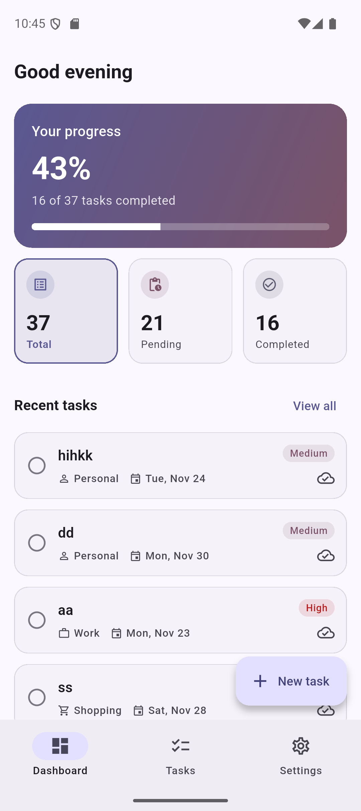
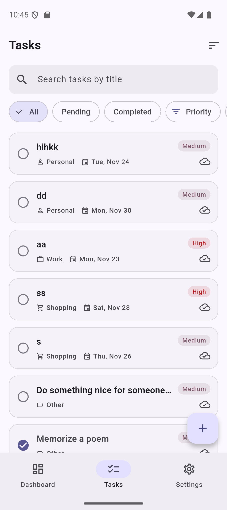
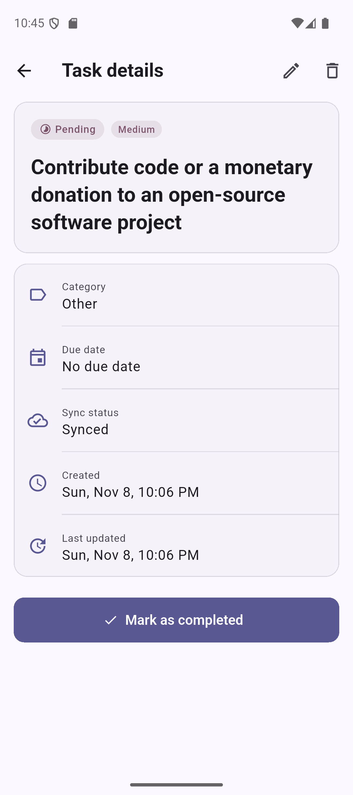
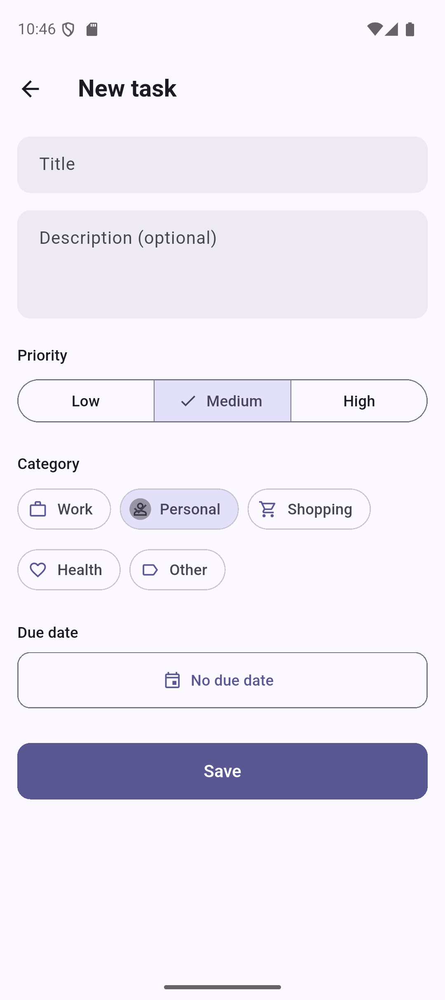
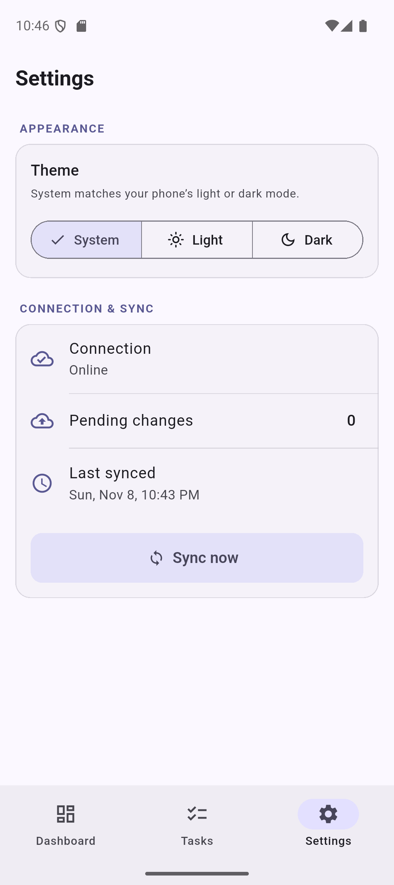
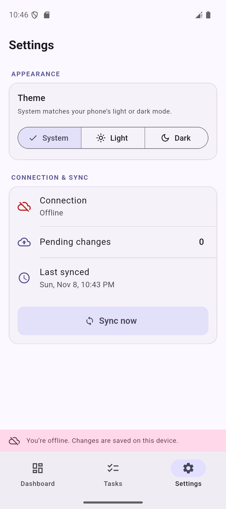
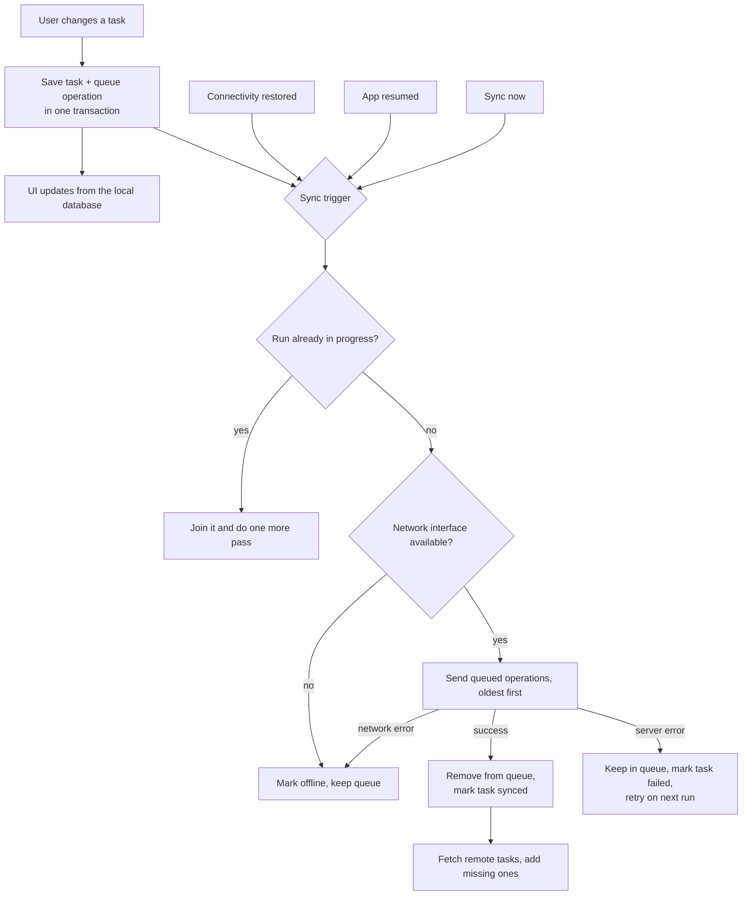

# Smart Task Manager

An offline-first task manager built with Flutter. Tasks can be created, edited, completed, searched, filtered and deleted without a connection; every change is stored locally first and synchronized with a remote API when it becomes reachable.

## Contents

- [Screenshots](#screenshots)
- [Features](#features)
- [Getting started](#getting-started)
- [Architecture](#architecture)
- [State management and dependency injection](#state-management-and-dependency-injection)
- [Local persistence](#local-persistence)
- [Offline-first synchronization](#offline-first-synchronization)
- [Conflict resolution](#conflict-resolution)
- [Engineering decisions](#engineering-decisions)
- [Testing](#testing)
- [Known limitations](#known-limitations)
- [Scaling to multiple users and thousands of tasks](#scaling-to-multiple-users-and-thousands-of-tasks)

## Screenshots

| Dashboard | Tasks | Task details |
| :---: | :---: | :---: |
|  |  |  |

| Add / edit task | Settings | Offline |
| :---: | :---: | :---: |
|  |  |  |

## Features

- **Task management**: create, view, edit, delete, complete and reopen tasks with a title, optional description, priority, category and due date. Creation and last-update times are stored for every task.
- **Dashboard**: progress overview, summary cards (total, pending, completed) that filter the list in place, and the most recent tasks.
- **Tasks list**: debounced title search; filters by status, priority and category; sorting by creation or due date; lazy loading in pages of 20.
- **Offline-first**: the app always reads from the local database, works fully offline and keeps every change across restarts.
- **Automatic sync**: queued changes are sent when a connection returns, when the app comes back to the foreground, or on demand from Settings.
- **Sync status**: each task shows whether it is synced, pending or failed; Settings shows the connection, pending and failed changes and the last sync time; an offline banner appears when the server can't be reached.
- **Light and dark themes**, accessible labels and validation with clear error messages.

## Getting started

### Requirements

| Tool | Version |
| --- | --- |
| Flutter | 3.47.5 (stable) |
| Dart | 3.13.4 |
| Platforms | Android, iOS |

No API keys or secrets are needed.

### Setup

```bash
git clone https://github.com/Nourn117/smart-task-manager.git
cd smart-task-manager
flutter pub get
dart run build_runner build
```

Generated files (`*.freezed.dart`, `*.g.dart`) are committed, so `build_runner` is only required after changing a model, state or table.

### Run

```bash
flutter run
```

The API base URL defaults to `https://dummyjson.com` and can be overridden without code changes:

```bash
flutter run --dart-define=API_BASE_URL=https://my-api.example.com
```

### Test

```bash
flutter analyze
flutter test
```

### Packages

| Package | Purpose |
| --- | --- |
| `flutter_bloc` | Cubit state management |
| `get_it` | Dependency injection |
| `freezed`, `freezed_annotation` | Immutable entities, DTOs and states |
| `drift`, `drift_flutter`, `drift_dev` | SQLite local database |
| `dio` | HTTP client |
| `connectivity_plus` | Network interface changes |
| `uuid` | Stable local task ids |
| `build_runner` | Code generation |
| `mocktail` | Mocks and fakes in tests |

## Architecture

The project follows Clean Architecture with three layers. Dependencies point inwards: presentation and data depend on the domain, and the domain depends on neither of them nor on Flutter, Dio or the database.

```
lib/
├── core/                  Shared infrastructure
│   ├── database/          Drift database and tables
│   ├── di/                GetIt registrations
│   ├── errors/            Failures (domain) and remote exceptions (data)
│   ├── network/           Dio client and connectivity
│   ├── routing/           Routes and the home shell (tabs)
│   ├── theme/             Light/dark themes and snack bars
│   └── utils/             Result type and typedefs
├── domain/                Pure Dart business rules
│   ├── entities/          Task, TaskQuery, TaskSummary, SyncOverview
│   ├── repositories/      TaskRepository, SyncRepository contracts
│   └── usecases/          One class per operation
├── data/                  Implementation details
│   ├── datasources/       Local (Drift) and remote (Dio) data sources
│   ├── models/            API DTOs and mappers
│   └── repositories/      Repository implementations and the sync engine
└── presentation/          One folder per screen
    ├── dashboard/         cubit/, widgets/, dashboard_page.dart
    ├── tasks/
    ├── task_details/
    ├── task_form/
    ├── settings/
    ├── sync/              App-wide sync status and offline banner
    └── shared/            Widgets and helpers used by several screens
```

**Why layer-first instead of `features/<name>/`?** The app has a single business domain (tasks), so a feature folder would wrap everything in one extra level without separating anything. Organizing by layer keeps the dependency rule visible in the folder structure, and the presentation layer is still split per screen so each page lives next to its Cubit and widgets. If more domains were added, they would get their own sub-folders inside each layer.

### Data flow

```
Widget ──▶ Cubit ──▶ Use case ──▶ Repository (contract) ──▶ Local data source ──▶ SQLite
   ▲                                                                                 │
   └────────────── stream of updated rows (Drift reactive query) ◀──────────────────┘
```

1. A widget calls a Cubit method (for example `TaskFormCubit.submit`).
2. The Cubit calls a use case (`CreateTask`), which validates the input and builds the entity.
3. The repository saves it locally and queues a sync operation in one transaction, then returns a `Result` (`Ok` or `Err` with a `Failure`).
4. The UI never waits for the network: Drift's reactive queries push the new data to every Cubit watching it.
5. Separately, the sync engine sends the queued operation to the API when it is reachable.

## State management and dependency injection

- **One Cubit per screen** (`DashboardCubit`, `TasksCubit`, `TaskDetailsCubit`, `TaskFormCubit`) plus app-wide `ThemeCubit` and `SyncCubit`. This is the "clearly justified equivalent" of a single `TaskCubit`: each Cubit owns one screen's state, which keeps it small and easy to test.
- **Immutable states** built with freezed cover loading, loaded, empty and error conditions. `TaskDetailsState` is a sealed union, so the UI handles every case with an exhaustive `switch`.
- Cubits cancel their subscriptions and timers in `close()` and check `isClosed` after every `await`, so they never emit after disposal.
- **GetIt** registrations live in `core/di/injection.dart`: lazy singletons for the database, network clients, data sources, repositories and use cases, and factories for Cubits.

## Local persistence

**Drift (SQLite)** was chosen over Hive and Isar because:

- The data is relational: tasks and their pending sync operations are linked by a foreign key.
- **Transactions** let a task change and its queue entry be saved atomically, so a change can never be stored without its sync operation (or the other way round).
- Reactive queries keep every screen up to date without manual refreshes.
- Search, filters, sorting and pagination run in SQL instead of in memory.
- It runs in-memory in tests, so persistence is tested without a device.

Two tables are used:

| Table | Purpose |
| --- | --- |
| `tasks` | Every task, including `remoteId`, `syncStatus` and an `isDeleted` tombstone |
| `sync_queue` | At most one pending operation (`create`, `update`, `delete`) per task, with retry metadata |

Tasks use a **stable local UUID** as their primary key. The server id is stored separately in `remoteId` (null until uploaded), so locally created tasks never depend on the server.

## Offline-first synchronization



Key rules implemented in `SyncRepositoryImpl` and `TaskLocalDataSource`:

- **Local first**: every change is saved locally before success is reported to the UI; a failed request never discards it.
- **Persistent queue**: operations live in SQLite and survive restarts.
- **Queue coalescing**: there is one operation per task. Editing a task that was never uploaded keeps the pending `create` (which uploads the latest state); deleting it removes it entirely without a server call; deleting a synced task keeps a tombstone and queues a `delete`.
- **No overlapping runs**: a second sync request while one is running joins it, and changes made meanwhile get one more pass.
- **No duplicate submissions**: an operation is only removed after the server accepts it. If the task was edited while its `create` was uploading, the entry becomes an `update` instead of a second `create`.
- **Metadata after success only**: `syncStatus` becomes `synced` only when the server confirms the operation.
- **Reachability**: `connectivity_plus` only reports network interfaces, so failed requests (timeouts, DNS errors, dropped connections) also mark the app as offline. Server errors mark the task as failed and keep it queued for a retry.
- **Non-blocking**: local operations never wait for a network request.

## Conflict resolution

The intended strategy is **last-write-wins using `updatedAt`**: when the same task changes locally and remotely, the version with the newer `updatedAt` is kept.

DummyJSON does not return an `updatedAt`, so the rules applied here are:

1. A task with a pending local change is never overwritten by the server; the local change is uploaded and wins.
2. Remote tasks the device doesn't have yet are added locally.
3. Tasks that already exist locally, including deleted ones (tombstones), are not overwritten by the server's copy.

**Limitations of last-write-wins**: it depends on device clocks being correct, and it keeps one whole version of the task, so if two devices edit different fields of the same task before syncing, one device's edits are lost. Field-level merging, server-assigned version numbers or showing conflicts to the user would avoid this.

## Engineering decisions

- **Debounced search**: the search query is applied 300 ms after the user stops typing.
- **Lazy loading**: the list loads 20 tasks at a time and requests the next page near the end of the scroll.
- **Rebuild optimization**: the filter bar and sort button use `BlocSelector` on the query only, and the list's `buildWhen` ignores query-only changes, so typing or switching filters doesn't rebuild the whole screen.
- **Duplicate submissions**: the Save button is disabled while saving and `TaskFormCubit` ignores a second submit while one is in progress.
- **App lifecycle**: the form uses Flutter state restoration, so unsaved input survives the app being killed in the background, and every saved change is already in SQLite.
- **Error handling**: data sources throw typed exceptions (`NetworkException`, `ServerException`, `NotFoundException`, `InvalidResponseException`); repositories turn them into `Failure`s or sync status, so the UI only shows user-friendly messages.
- **Centralized API configuration**: base URL and timeouts live in `core/network/api_client.dart`; JSON is validated with pattern matching and malformed responses become `InvalidResponseException`.

## Testing

All tests use mocks or an in-memory database and never call the real API.

| Area | What is covered |
| --- | --- |
| Use cases | Create, update, delete and complete/reopen, including validation |
| Local data source | Filtering, search, sorting, pagination, queue coalescing, tombstones, persistence across restarts |
| Remote data source | Parsing, malformed responses, timeouts, connection errors, 404 and server errors |
| Sync engine | Uploads, retries after failures, offline behaviour, 404 handling, no overlapping runs, edits during an upload, merging remote tasks, automatic triggers |
| Cubits | Initial, loading, loaded, empty and error states; create/update/delete/complete flows; debounced search; duplicate-submit prevention; sync status transitions |
| Widgets | Task list and empty states, search and filters, form validation, delete confirmation, restoring form input after a restart, offline banner and sync status |

```bash
flutter test
```

Latest result: **117 tests, all passing**.

## Known limitations

- **DummyJSON does not store writes.** `POST`, `PUT` and `DELETE` are simulated, so changes are kept locally and the local database stays the source of truth. Every created task receives the same simulated id from the server; when a later update for it returns `404`, the task is uploaded again, and a `404` on delete is treated as already deleted.
- **Remote tasks have no priority, category, description or due date**, so imported tasks use Medium priority and the Other category.
- Only the first 30 remote tasks are fetched.

## Scaling to multiple users and thousands of tasks

- **Accounts and authentication**, with every task and queue entry scoped to a user id.
- **Incremental sync**: fetch only tasks changed since the last sync (`updatedAt > lastSyncedAt`) with server-side pagination, instead of a fixed page.
- **Server-side versions** (or timestamps assigned by the server) for reliable conflict detection, with field-level merges.
- **Batch uploads** and exponential backoff for retries.
- **Database indexes** on `remoteId`, `isDeleted`, `createdAt` and `dueDate`, and full-text search for titles.
- **Background sync** with WorkManager (Android) and BGTaskScheduler (iOS).
